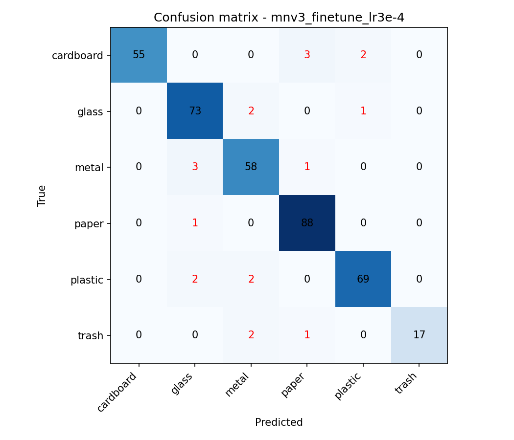
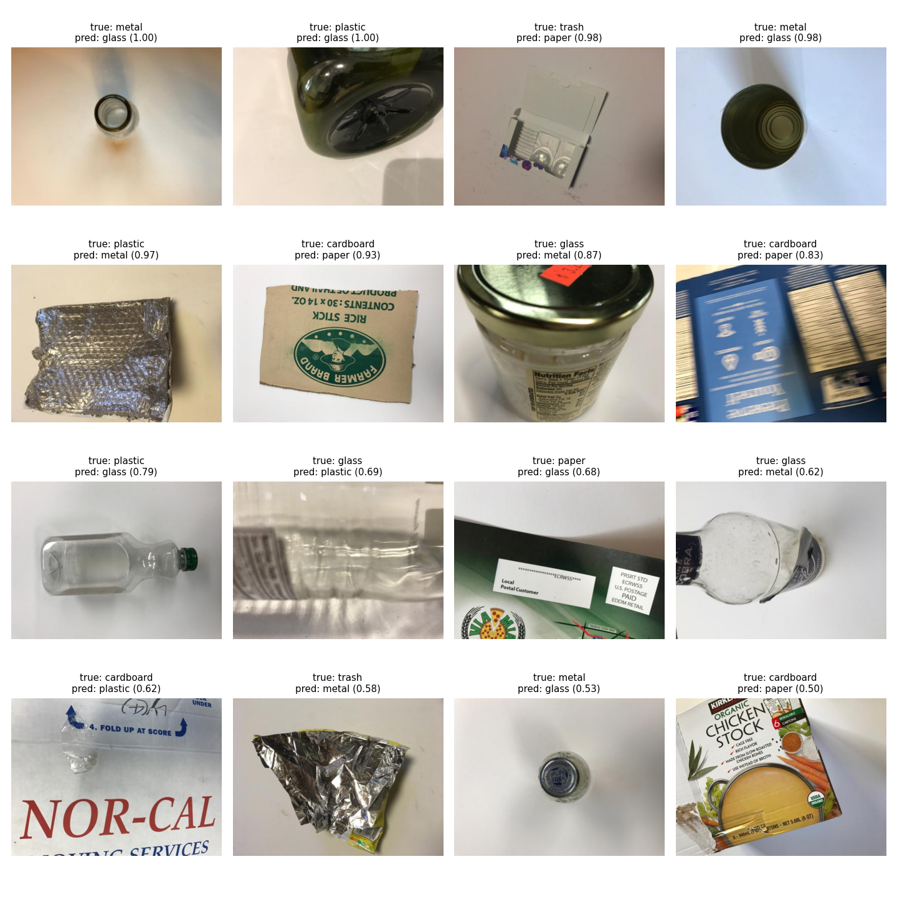

# Waste Image Classifier (TrashNet)

Image classification of household waste into 6 classes (cardboard, glass, metal, paper, plastic, trash), built as a compute-aware, deployment-ready ML engineering prototype.

**Live demo:** <<PASTE YOUR HUGGING FACE SPACE URL HERE>>

## 1. Problem framing and dataset
- **Task:** multi-class image classification.
- **Dataset:** TrashNet (Thung & Yang), loaded from the Hugging Face repo `garythung/trashnet`.
- **Why this dataset:** it is a real-world problem (waste sorting), small enough to train on a free Colab T4, has natural class imbalance, and contains visually confusable classes (plastic/glass, paper/cardboard), which makes error analysis meaningful.

## 2. Data understanding
| Class | Images | Share |
|---|---|---|
| paper | 594 | 23.5% |
| glass | 501 | 19.8% |
| plastic | 482 | 19.1% |
| metal | 410 | 16.2% |
| cardboard | 403 | 15.9% |
| trash | 137 | 5.4% |

- **Total:** 2,527 images. **Label format:** one folder per class (ImageFolder), integer labels. **Image size:** 512x384 (4:3 phone photos).
- **Data-quality issue found:** the Hugging Face repo ships both `dataset-original.zip` and `dataset-resized.zip`. The default loader merged them into 5,054 rows, i.e. every photo twice, which would have leaked identical images across train/test. I use only the resized archive (2,527 unique images).
- **Limitations:**
  - `trash` is about 4x smaller than `paper`.
  - Most photos have plain light backgrounds, so the model may not generalise to cluttered real-world scenes.
  - `trash` is a catch-all class with high internal variety.
  - Some classes look alike (transparent plastic vs glass, flat paper vs cardboard).
  - TrashNet contains many photos of the same physical objects from different angles. A random split can therefore place near-duplicates in both train and test, so the test score is probably optimistic (not verified here; a group-aware split would be the fix).

## 3. Preprocessing, augmentation, imbalance
- **Split:** stratified 70/15/15 train/val/test (1,768 / 379 / 380 images), fixed seed (42). The test set is used only once, for final evaluation. Model selection uses validation macro-F1.
- **Preprocessing:** resize to 224x224, ImageNet mean/std normalisation.
- **Augmentation (train only):** random resized crop (scale 0.7-1.0), horizontal flip, rotation (15 degrees), colour jitter. Chosen because the photos vary in lighting, tint and orientation.
- **Imbalance:** inverse-frequency class weights in the cross-entropy loss, and macro-F1 as the main metric (accuracy alone hides weak minority-class performance).

## 4. Models and training
| Run | Model | Setup | LR | Epochs | Val macro-F1 | Val acc |
|---|---|---|---|---|---|---|
| baseline_cnn | Small 4-block CNN (from scratch) | all layers | 1e-3 | 20 | 0.705 | 0.726 |
| mnv3_frozen_lr1e-3 | MobileNetV3-Large (ImageNet) | frozen backbone, new head | 1e-3 | 8 | 0.862 | 0.873 |
| mnv3_finetune_lr3e-4 | MobileNetV3-Large (ImageNet) | full fine-tune | 3e-4 | 10 | **0.927** | **0.931** |
| mnv3_finetune_lr1e-4 | MobileNetV3-Large (ImageNet) | full fine-tune | 1e-4 | 10 | 0.901 | 0.918 |

**Why these models:** the baseline shows what a small CNN can do without pre-training. Transfer learning is justified because the dataset is small (about 1.8k training images). MobileNetV3 gives strong ImageNet features at a small size, so it trains quickly on a free GPU and loads fast on a CPU host. Hyperparameter tuning was kept small and deliberate (frozen vs fine-tuned backbone, learning rate), in line with compute limits. AdamW with cosine LR schedule.

**Selected model:** `mnv3_finetune_lr3e-4` (highest validation macro-F1, 0.927). Full fine-tuning at LR 3e-4 beat both a frozen backbone (0.862) and a lower LR of 1e-4 (0.901), which converged more slowly within 10 epochs. The scratch CNN reached only 0.705, which confirms transfer learning is justified on ~1.8k training images. Training macro-F1 reaches 0.996 versus 0.92 on validation, so the model overfits somewhat; the best checkpoint was selected by validation macro-F1 rather than the last epoch.

## 5. Test results
Evaluated once on the held-out test set (380 images) with the selected model:

```
              precision    recall  f1-score   support

   cardboard      1.000     0.917     0.957        60
       glass      0.924     0.961     0.942        76
       metal      0.906     0.935     0.921        62
       paper      0.946     0.989     0.967        89
     plastic      0.958     0.945     0.952        73
       trash      1.000     0.850     0.919        20

    accuracy                          0.947       380
   macro avg      0.956     0.933     0.943       380
weighted avg      0.949     0.947     0.947       380
```

**Baseline CNN vs final model on test:** macro-F1 0.645 vs **0.943**, accuracy 0.663 vs **0.947** (128 vs 20 errors out of 380).




## 6. Error analysis
**Quantitative:**
- Weakest classes are `metal` (F1 0.921, lowest precision 0.906 because glass/plastic/trash items are read as metal) and `trash` (F1 0.919, recall 0.850: 3 of 20 missed, all predicted as metal or paper). `trash` has 20 test images, so its numbers are noisy.
- Most frequent confusions: cardboard to paper (3), metal to glass (3), and several pairs with 2 each (cardboard to plastic, glass to metal, plastic to glass, plastic to metal, trash to metal).
- Class weighting helped the minority class: `trash` precision is 1.000, but recall is still the lowest, so more minority data is the main lever.

**Qualitative failure modes (from the misclassified grid):**
1. **Transparent and reflective objects:** clear plastic bottles are predicted as glass, and a glass jar with a metal lid is predicted as metal.
2. **Material and texture ambiguity:** crumpled foil and foil-like packaging are called metal when labelled `trash` or `plastic`; printed or blurry cardboard is called paper.
3. **Unusual viewpoints and framing:** a can seen from the inside, or a tiny bottle cap in the middle of a large empty frame, is predicted as glass with high confidence.
4. **Probable label noise:** some of the most confident errors (confidence 1.00) look questionable, e.g. an item labelled `plastic` that appears to be a dark glass bottle, and a `metal` item that appears to be a glass bottle neck. A label audit is warranted.

**Improvement hypotheses:**
- Collect more varied backgrounds and `trash` samples to reduce the plain-background shortcut.
- Stronger augmentation (background replacement, random erasing) and higher input resolution for texture-based confusions.
- Label audit of the confusable pairs and the confident errors, then re-evaluate.
- Test-time augmentation or ensembling.

## 7. Deployment
- **Live endpoint:** <<SPACE URL>> (web UI for image upload and prediction; also exposes an API through Gradio).
- Inference code lives in `src/inference/predictor.py`; the app is in `app/app.py`.

## 8. Project structure
```
configs/config.yaml     # paths, split sizes, image size, seed
src/data/download.py    # downloads the resized TrashNet archive into data/
src/data/dataset.py     # loading, stratified split, transforms, class weights
src/models.py           # baseline CNN and MobileNetV3
src/train.py            # training with logging, best-checkpoint saving, results log
src/evaluate.py         # test metrics, confusion matrix, error grid
src/inference/          # predictor used by the app
app/app.py              # Gradio app
outputs/figures/        # EDA and evaluation figures
outputs/results.csv     # all training runs
models/best_model.pt    # selected checkpoint used by the app
```

## 9. Reproduce
1. Open the training notebook in Google Colab (T4 GPU) and run top to bottom, or:
```bash
pip install torch torchvision datasets pyyaml scikit-learn matplotlib huggingface_hub
python -m src.data.download
python -m src.train --model mobilenet --tag mnv3_finetune --lr 3e-4 --epochs 10
python -m src.evaluate --tag mnv3_finetune
```
2. Configuration is in `configs/config.yaml`.

## 10. With more compute
- Fine-tune larger backbones (EfficientNet-B3, ConvNeXt, ViT) with longer schedules and a proper hyperparameter search.
- Train on larger, more diverse waste datasets (e.g. TACO, Waste Classification Data) for robustness to real scenes.
- Cross-validation, ensembling, and calibration of confidence scores.
- Move to object detection or segmentation for multi-item scenes.
